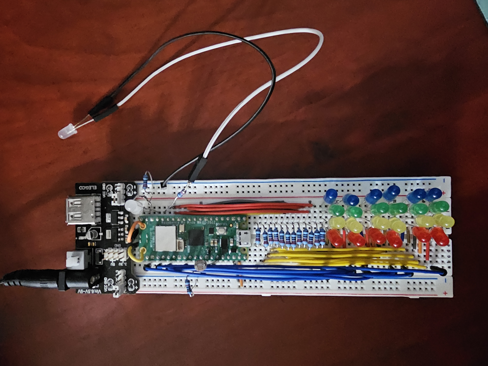
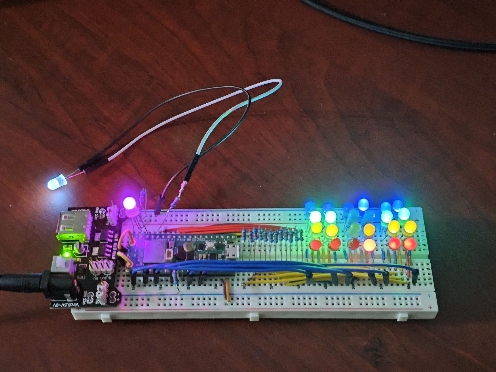
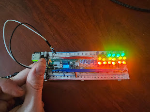
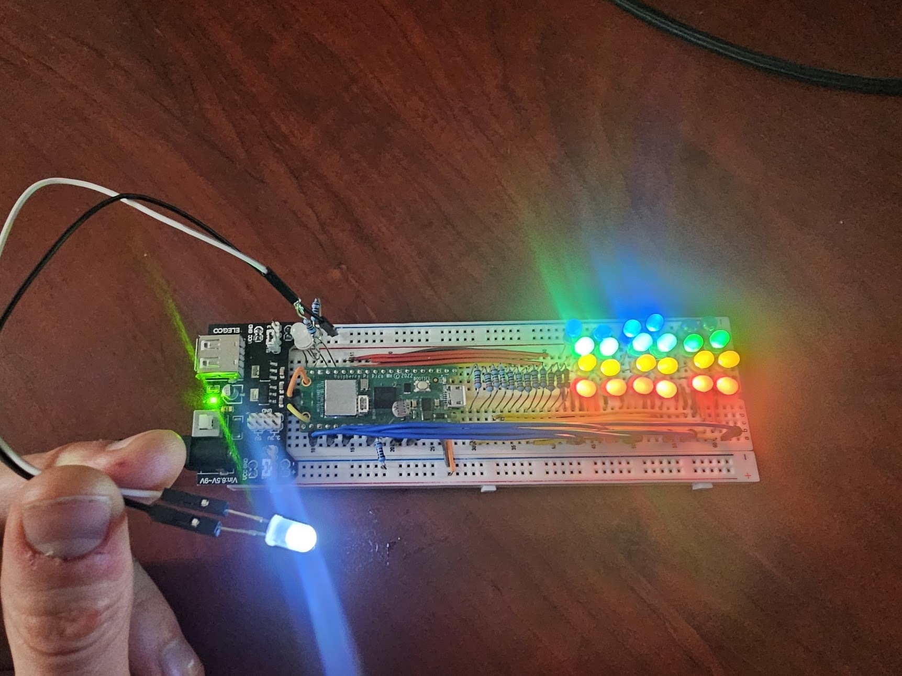
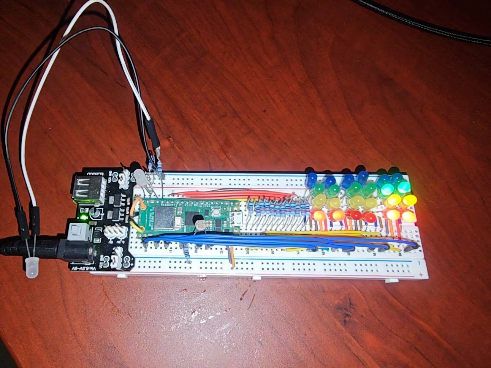

# Dancing Lights

A Pi Pico, some LEDs, and a dream!

This firmware configures a Raspberry Pi Pico W to control colored LEDs and other peripherals, using different behavior modes that are selected at runtime.  This firmware is created with [Embassy](https://embassy.dev/), and flashed using probe-rs with a SWD probe.

# Setup

The breadboard contains on a Raspberry Pi Pico W connected to three groups of colored LEDs, an RGB LED, a photoresistor, and a separate LED on jumper wires. Resistors limit LED current and form the photoresistor's sensing circuit using a voltage divider, while a breadboard power module supplies the power rails.

Each pair of same-colored LEDs shares a PWM-controlled pin along one side of the Pico, connected through overlapping wire and resistor runs. Each column shares a ground connection controlled by a regular GPIO pin on the opposite side. The RGB and standalone LEDs also use PWM outputs on the same side as the arrays' color controls.

The colored LED groups display lighting effects, including randomized effects and PID feedback guages. The separate LED can be moved closer to or farther from the photoresistor to experiment with automatic brightness control.

# Runtime modes

Press and release the Pico's **BOOTSEL** button to advance through **Dance → On → Off → Feedback**, then wrap back to Dance. The LEDs reset before each new mode begins.

## Dance

Runs several effects concurrently:

- **LED arrays:** Randomizes each color's brightness and selects one or both columns every 250 ms.
- **RGB LED:** Continuously cycles through the rainbow.
- **Standalone LED:** Fades up and down along a repeating two-second sine wave.
- **Onboard LED:** Flashes briefly once per second.
- **Photoresistor:** Logs the light reading every five seconds.

## On / Off

Turns all LEDs on at full brightness or turns them all off.

## Feedback

| Low light | Normal light | Bright light |
|:---:|:---:|:---:|
|  |  |  |

Adjusts the standalone LED's brightness to bring the photoresistor reading toward a target. Moving the LED relative to the sensor demonstrates how the controller responds to changes in illumination.

The arrays act as level gauges for the PID contributions: **left = proportional (P)**, **middle = integral (I)**, and **right = derivative (D)**. Each gauge uses its own numeric range. As its value rises, the red, yellow, green, and blue channels progressively illuminate, fading between thresholds.
